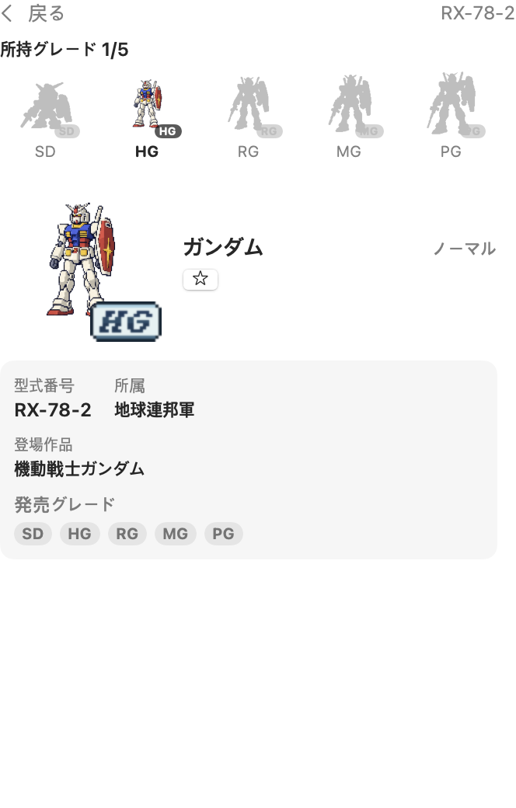

# MSTokenBar

[English](README.md) · [한국어](README.ko.md)

**[ドット絵カタログを見る](https://hongnamkim.github.io/MSTokenBar/catalog/)**

すでに使っている AI コーディングトークン（Claude Code・Codex・Gemini CLI など）を、ガンプラ（ガンダムのプラモデル）の制作進行度に変える macOS メニューバーアプリです。[chattymin/PokeTokenBar](https://github.com/chattymin/PokeTokenBar) をガンプラテーマにしたフォークです。

> 開発中: ドット絵スプライトは作品ごとに制作しており、発売された全グレードの絵がそろった機体だけが登場します。現在のカタログには『機動戦士ガンダム』『第08MS小隊』『0080 ポケットの中の戦争』『0083 STARDUST MEMORY』『THE ORIGIN』『サンダーボルト』『ククルス・ドアンの島』『機動戦士Ζガンダム』『機動戦士ガンダムΖΖ』『逆襲のシャア』と小説『ベルトーチカ・チルドレン』の計 97 機を収録しています。全リスト（宇宙世紀 16 作品・128 機）は引き続き制作中です。トークン使用量の追跡は元プロジェクトから引き継いだ機能です（対応ツールは[元の README](https://github.com/chattymin/PokeTokenBar#readme) を参照）。

## 仕組み

- **開封**: AI コーディングトークンを使うとキットボックスが開き、機体が登場します。
- **グレードアップ**: さらに使うと、その機体で実際に発売されたキットのグレードを順に上がります（SD → MGSD → HG → RG → MG → Ver.Ka → MGEX → PG）。発売されていないグレードは飛ばし、あとからカタログにキットのグレードが加わると、完成した機体がそのグレードを作りに再登場します。
- **完成**: 最終グレードに到達すると機体が完成し、格納庫に保存され、新しいキットボックスが届きます。完成した機体は、すべての機体を完成させるまで再登場しません。
- **専用機**: シャア専用ザク II のような指揮官機・エース専用機は、ベース機のレアな変種として登場します。ショップの塗装ツール（マスキングテープ → スミ入れペン → 塗料セット → エアブラシ）で確率を永続的に上げられます。
- **格納庫**: 機体ごとに 1 マスで、作ったグレードをすべて記録します。まだ作っていない機体は、型式番号だけを手がかりにしたシルエットで表示されます。作品別に絞り込めて、作品をコンプリートするとバッジがもらえます。
- **アイテム**: スポンジヤスリは即座に成長させ、アンコモン／レアボックスはレアリティを保証します。

| 格納庫 | 機体詳細 |
| ------ | -------- |
|  |  |

## 動作環境

macOS 14 以降。

## インストール

1. 最新の[リリース](https://github.com/HongnamKim/MSTokenBar/releases/latest)から `MSTokenBar.zip` をダウンロードします。
2. 解凍して `MSTokenBar.app` を「アプリケーション」フォルダに移動します。
3. Apple の公証を受けていないため、初回起動時はアプリを右クリックして**開く**を選びます。

新しいバージョンが出るとアプリにアップデートバナーが表示されます。**アップデート**を押すと、アプリがリリースをダウンロードして署名を確認し、自分自身を置き換えて再起動します。0.1.1 以前のバージョンはリリースページを開くだけなので、一度だけ zip を手動でダウンロードして置き換えてください。

## バージョン規則

作品単位で完成したドット絵を追加するたびにマイナーバージョンを上げます（0.1.0、0.2.0、…）。宇宙世紀の全作品を描き終えたら 1.0.0 を出します。

## ソースからビルド

```bash
git clone https://github.com/HongnamKim/MSTokenBar.git
cd MSTokenBar
scripts/build-app.sh      # build/MSTokenBar.app を作成し /Applications にインストール
```

## クレジット

chattymin 氏の [PokeTokenBar](https://github.com/chattymin/PokeTokenBar) のフォークです。元の MIT ライセンスと著作権表示は [LICENSE](LICENSE) にそのまま残しています。

## 免責

非公式・非営利のファンプロジェクトです。バンダイナムコ・サンライズとは無関係です。原作品の権利はすべて各権利者に帰属します。
(Unofficial, non-commercial fan project. Not affiliated with Bandai Namco or Sunrise. All rights to the original works belong to their owners.)
