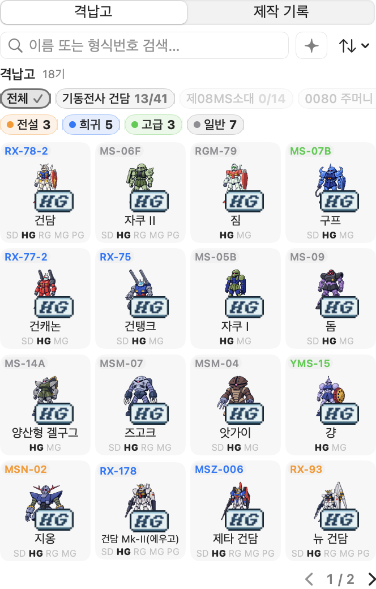
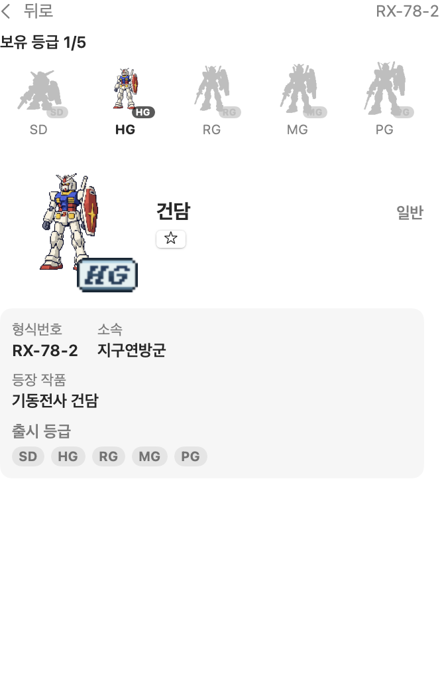

# MSTokenBar

[English](README.md) · [日本語](README.ja.md)

**[도트 카탈로그 보기](https://hongnamkim.github.io/MSTokenBar/catalog/)**

이미 쓰고 있는 AI 코딩 토큰(Claude Code, Codex, Gemini CLI 등)을 건프라(건담 플라스틱 모델) 제작 진행도로 바꿔 주는 macOS 메뉴바 앱입니다. [chattymin/PokeTokenBar](https://github.com/chattymin/PokeTokenBar)를 건프라 테마로 포크한 프로젝트입니다.

> 개발 중: 도트 스프라이트를 작품 단위로 그리고 있으며, 출시된 모든 등급의 그림이 준비된 기체만 등장합니다. 현재 카탈로그에는 「기동전사 건담」, 「제08MS소대」, 「0080 주머니 속의 전쟁」, 「0083 스타더스트 메모리」, 「디 오리진」, 「썬더볼트」, 「쿠쿠루스 도안의 섬」, 「Z건담」, 「건담 ZZ」, 「역습의 샤아」, 소설 「벨토치카 칠드런」, 「건담 UC」의 기체 111기가 들어 있습니다. 전체 명단(우주세기 16개 작품, 130기)은 계속 그리는 중입니다. 토큰 사용량 추적은 원본 프로젝트에서 그대로 가져온 기능입니다(지원 도구는 [원본 README](https://github.com/chattymin/PokeTokenBar#readme) 참고).

## 작동 방식

- **개봉**: AI 코딩 토큰을 쓰면 건프라 박스가 열리고 기체가 나옵니다.
- **등급 업**: 계속 쓰면 그 기체로 실제 출시된 키트 등급을 따라 올라갑니다(SD → MGSD → HG → RG → MG → Ver.Ka → MGEX → PG). 출시되지 않은 등급은 건너뛰고, 나중에 카탈로그에 키트 등급이 추가되면 완성한 기체가 그 등급을 만들러 다시 나옵니다.
- **완성**: 최종 등급에 도달하면 기체가 완성되어 격납고에 보존되고, 새 건프라 박스가 도착합니다. 완성한 기체는 모든 기체를 완성할 때까지 다시 나오지 않습니다.
- **전용기**: 샤아 전용 자쿠 II 같은 지휘관기·에이스 전용기는 기본기의 희귀한 변형으로 나옵니다. 상점의 도색 공구(마스킹 테이프 → 먹선펜 → 도료 세트 → 에어브러시)로 확률을 영구히 올릴 수 있습니다.
- **격납고**: 기체마다 한 칸에 만든 등급을 모두 기록합니다. 아직 만들지 않은 기체는 형식번호만 단서로 남긴 실루엣으로 보입니다. 작품별로 걸러 볼 수 있고, 작품을 다 모으면 완성 배지를 받습니다.
- **아이템**: 스펀지 사포는 즉시 성장시키고, 언커먼·레어 박스는 레어도를 보증합니다.

| 격납고 | 기체 상세 |
| ------ | --------- |
|  |  |

## 요구 사항

macOS 14 이상.

## 설치

1. 최신 [릴리스](https://github.com/HongnamKim/MSTokenBar/releases/latest)에서 `MSTokenBar.zip`을 내려받습니다.
2. 압축을 풀고 `MSTokenBar.app`을 「응용 프로그램」 폴더로 옮깁니다.
3. Apple 공증을 받지 않은 앱이라, 처음 실행할 때는 앱을 우클릭하고 **열기**를 누릅니다.

새 버전이 나오면 앱에 업데이트 배너가 뜹니다. **업데이트**를 누르면 앱이 릴리스를 내려받아 서명을 확인한 뒤 스스로 교체하고 다시 실행합니다. 0.1.1 이하 버전은 릴리스 페이지만 열리므로, 한 번은 zip을 직접 내려받아 교체해 주세요.

## 버전 규칙

작품 단위로 완성한 도트를 올릴 때마다 마이너 버전을 올립니다(0.1.0, 0.2.0, …). 우주세기 작품을 모두 그리면 1.0.0을 냅니다.

## 소스에서 빌드

```bash
git clone https://github.com/HongnamKim/MSTokenBar.git
cd MSTokenBar
scripts/build-app.sh      # build/MSTokenBar.app 을 만들고 /Applications 에 설치
```

## 출처

chattymin의 [PokeTokenBar](https://github.com/chattymin/PokeTokenBar)를 포크했습니다. 원본 MIT 라이선스와 저작권 표시는 [LICENSE](LICENSE)에 그대로 유지됩니다.

## 면책

비공식 비영리 팬 프로젝트입니다. 반다이남코·선라이즈와 무관하며, 원저작물의 모든 권리는 각 원저작자에게 있습니다.
(Unofficial, non-commercial fan project. Not affiliated with Bandai Namco or Sunrise. All rights to the original works belong to their owners.)
