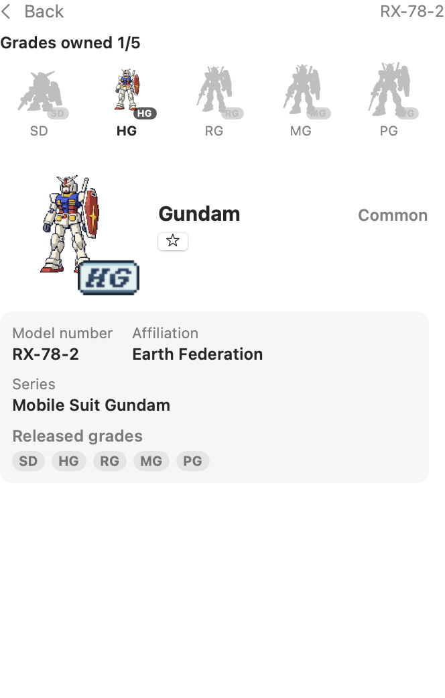

# MSTokenBar

[한국어](README.ko.md) · [日本語](README.ja.md)

A macOS menu-bar app that turns the AI coding tokens you already spend (Claude Code, Codex, Gemini CLI, and more) into Gunpla (plastic model kit) progress. It is a Gunpla-themed fork of [chattymin/PokeTokenBar](https://github.com/chattymin/PokeTokenBar).

> Work in progress: pixel sprites are drawn one series at a time, and only suits drawn for every released grade appear. Version 0.1.0 includes the 16 suits of *Mobile Suit Gundam*. The full roster (127 mobile suits from 15 Universal Century series) is still being drawn. Token usage tracking is inherited from the original project; see the [upstream README](https://github.com/chattymin/PokeTokenBar#readme) for the supported tools.

## How it works

- **Unbox**: spend AI coding tokens and your Kit Box opens. A mobile suit comes out.
- **Grade up**: keep spending and the suit climbs through the kit grades actually released for it: SD → MGSD → HG → RG → MG → PG. Grades that were never released are skipped.
- **Complete**: at its final grade the suit is complete. It is saved to your Hangar and a new Kit Box arrives. A completed suit does not come out again until you have completed every suit.
- **Customs**: commander and ace customs, such as Char's Zaku II, are rare variants of their base suit. Paint tools from the shop (Masking Tape → Panel Line Pen → Paint Set → Airbrush) raise the chance for good.
- **Hangar**: one cell per suit records every grade you have built. Filter by series and earn a badge for completing each one.
- **Items**: a Sanding Sponge gives instant progress, and Uncommon or Rare Boxes guarantee a rarity tier.

| Hangar | Suit detail |
| ------ | ----------- |
|  |  |

## Requirements

macOS 14 or later.

## Install

1. Download `MSTokenBar.zip` from the latest [release](https://github.com/HongnamKim/MSTokenBar/releases/latest).
2. Unzip it and move `MSTokenBar.app` to Applications.
3. The app is not notarized by Apple. On first launch, right-click it and choose **Open**.

When a new version is out, the app shows an update banner. Download the new zip and replace the app.

## Versioning

Each finished series of sprites raises the minor version (0.1.0, 0.2.0, …). Version 1.0.0 ships when every Universal Century series is drawn.

## Build from source

```bash
git clone https://github.com/HongnamKim/MSTokenBar.git
cd MSTokenBar
scripts/build-app.sh      # builds build/MSTokenBar.app and installs it to /Applications
```

## Credits

Forked from [PokeTokenBar](https://github.com/chattymin/PokeTokenBar) by chattymin. The original MIT license and copyright notice are kept in [LICENSE](LICENSE).

## Disclaimer

Unofficial, non-commercial fan project. Not affiliated with Bandai Namco or Sunrise. All rights to the original works belong to their owners.
