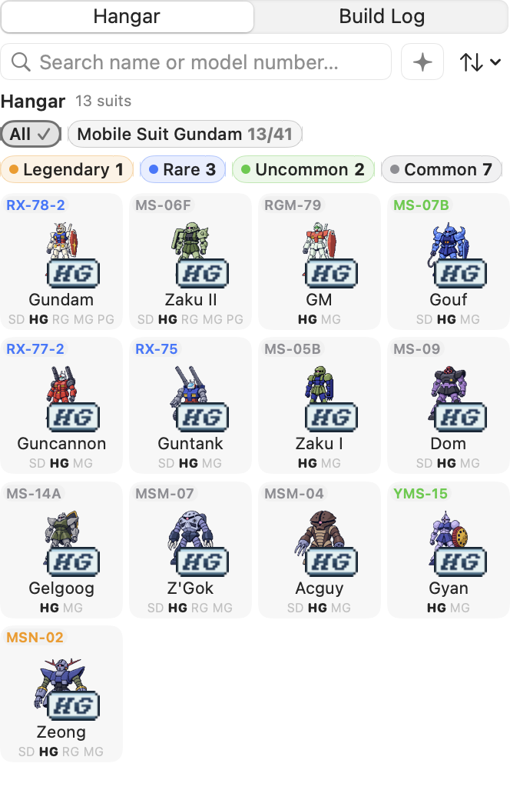
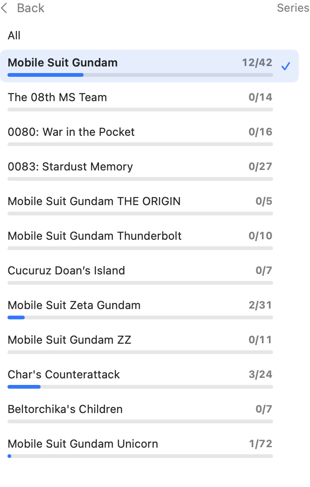
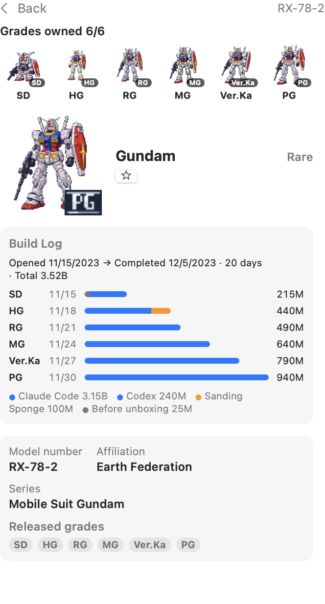
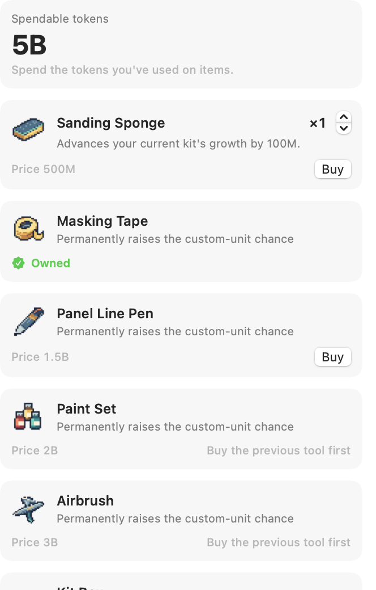
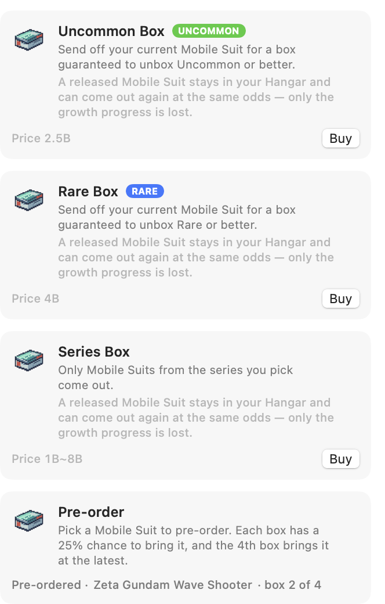
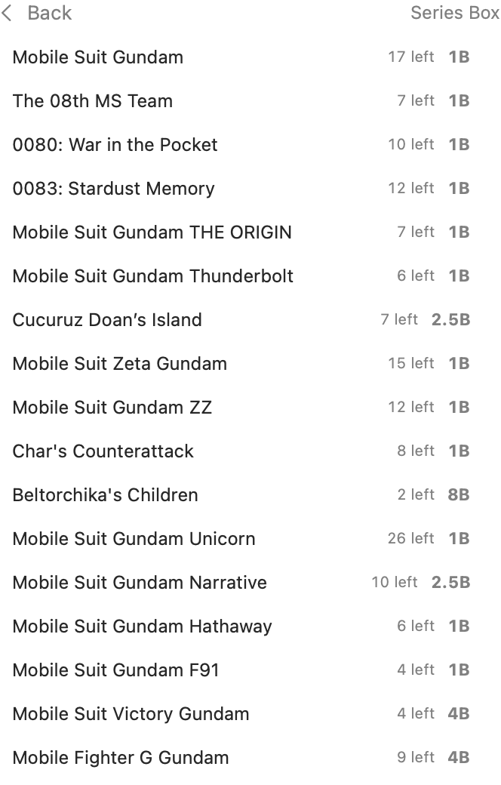

# MSTokenBar

[한국어](README.ko.md) · [日本語](README.ja.md)

**[Browse the sprite catalog](https://hongnamkim.github.io/MSTokenBar/catalog/)**

A macOS menu-bar app that turns the AI coding tokens you already spend (Claude Code, Codex, Gemini CLI, and more) into Gunpla (plastic model kit) progress. It is a Gunpla-themed fork of [chattymin/PokeTokenBar](https://github.com/chattymin/PokeTokenBar).

> The hangar includes 247 entries from 28 works, with 604 pixel sprites covering their released grades, modes and equipment. Token usage tracking is inherited from the original project; see the [upstream README](https://github.com/chattymin/PokeTokenBar#readme) for the supported tools.

## How it works

- **Unbox**: spend AI coding tokens and your Kit Box opens. A mobile suit comes out.
- **Grade up**: keep spending and the suit climbs through the kit grades actually released for it: SD → MGSD → HG → RG → MG → Ver.Ka → MGEX → PG. Grades that were never released are skipped, and when a kit grade is added to the catalog later, a completed suit comes back to build it.
- **Complete**: at its final grade the suit is complete. It is saved to your Hangar and a new Kit Box arrives. A completed suit does not come out again until you have completed every suit.
- **Customs**: commander and ace customs, such as Char's Zaku II, are rare variants of their base suit. Paint tools from the shop (Masking Tape → Panel Line Pen → Paint Set → Airbrush) raise the chance for good.
- **Hangar**: one cell per suit records every grade you have built. Suits you have not built yet appear as silhouettes with only their model number as a clue. Filter by series and earn a badge for completing each one.
- **Build record**: every build keeps a record of when its box was opened, when each grade was reached and how many tokens each tool contributed. The suit's detail page shows it as one bar per grade, split by source.
- **Items**: a Sanding Sponge gives instant progress, and Uncommon or Rare Boxes guarantee a rarity tier.
- **Pre-orders and Series Boxes**: pre-order one suit you have not completed, and every box that opens has a 25% chance to bring it, with the 4th box bringing it at the latest. A Series Box only opens suits from the series you pick.

| Hangar | Series list |
| --- | --- |
|  |  |

| Suit detail and build record | Shop |
| --- | --- |
|  |  |

| Series Box and Pre-order | Series Box list |
| --- | --- |
|  |  |

## Requirements

macOS 14 or later.

## Install

1. Download `MSTokenBar.zip` from the latest [release](https://github.com/HongnamKim/MSTokenBar/releases/latest).
2. Unzip it and move `MSTokenBar.app` to Applications.
3. The app is not notarized by Apple. On first launch, right-click it and choose **Open**.

When a new version is out, the app shows an update banner. Click **Update** and the app downloads the release, checks its signature, replaces itself and restarts. Versions 0.1.1 and earlier open the release page instead, so download the zip once by hand.

## Versioning

Version 1.0.0 completed every Universal Century series. From there, each sprite drop (one or more finished series) or new feature raises the minor version (1.1.0, 1.2.0, …), and fixes raise the patch version. 2.0.0 is kept for a major change to the app.

## Build from source

```bash
git clone https://github.com/HongnamKim/MSTokenBar.git
cd MSTokenBar
scripts/build-app.sh      # builds build/MSTokenBar.app and installs it to /Applications
```

## Credits

Forked from [PokeTokenBar](https://github.com/chattymin/PokeTokenBar) by chattymin. The original MIT license and copyright notice are kept in [LICENSE](LICENSE).

## Disclaimer

Unofficial, non-commercial fan project. Not affiliated with Bandai Namco or Sunrise. All rights to the original works belong to their owners.
